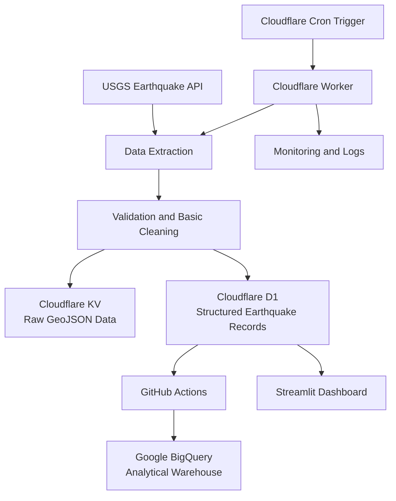

# 🌍 Earthquake Monitoring System

A cloud-based earthquake data engineering and monitoring system that automatically collects earthquake events from the **USGS Earthquake API**, validates and stores the data using Cloudflare services, and transfers structured records to Google BigQuery for analytical processing.

The system demonstrates an end-to-end cloud data engineering pipeline involving API ingestion, basic data processing, NoSQL storage, relational storage, data warehousing, scheduled execution and cloud-based automation.

## 🔗 Related Projects

This repository is the backend data engineering component of the Earthquake Monitoring project.

- **Interactive Dashboard:** [earthquake_monitoring_dashboard](https://github.com/Pawarasithumina/earthquake_monitoring_dashboard)
- **Live Dashboard:** [Open Earthquake Monitoring Dashboard](https://earthquakemonitoringdashboard-lkomffwk24fzph9xdsjmji.streamlit.app/)

The dashboard retrieves earthquake records from the protected read-only API provided by this repository.

---

## 📌 Project Overview

Earthquakes occur around the world every day. Public earthquake data provides valuable information about seismic activity, including magnitude, geographical location, depth and occurrence time.

This project implements an automated cloud-based system that collects earthquake information from the USGS Earthquake API and stores it using multiple cloud storage technologies.

The ingestion and processing operations execute within Cloudflare Workers rather than relying on a continuously running local computer.

The collected records are stored in Cloudflare KV and Cloudflare D1. A GitHub Actions workflow subsequently transfers the structured records from D1 to Google BigQuery.

### Main Objectives

- Collect earthquake event data from the USGS Earthquake API.
- Automate data ingestion using Cloudflare Cron Triggers.
- Perform basic data validation and cleaning.
- Store original API records in Cloudflare KV.
- Store cleaned and structured records in Cloudflare D1.
- Prevent duplicate records using unique earthquake event IDs.
- Transfer structured records to Google BigQuery.
- Automate cloud-to-cloud data transfer using GitHub Actions.
- Provide a protected read-only API for downstream applications.
- Support earthquake data exploration through an interactive dashboard.

---

## 🏗️ System Architecture



### Architecture Components

| Component | Technology | Responsibility |
|---|---|---|
| Data Source | USGS Earthquake API | Provides earthquake event data |
| Scheduler | Cloudflare Cron Triggers | Initiates scheduled ingestion |
| Processing | Cloudflare Workers | Executes extraction, validation and loading |
| NoSQL Storage | Cloudflare KV | Stores original JSON event data |
| Relational Storage | Cloudflare D1 | Stores structured earthquake records |
| Automation | GitHub Actions | Runs the D1-to-BigQuery transfer |
| Data Warehouse | Google BigQuery | Stores data for analytical queries |
| Authentication | Google Workload Identity Federation | Authenticates GitHub Actions with Google Cloud |
| Monitoring | Cloudflare Observability | Supports execution monitoring |
| Dashboard | Streamlit Community Cloud | Presents earthquake data visually |

---

## 🛠️ Technologies Used

### Cloud Infrastructure
- Cloudflare Workers
- Cloudflare Cron Triggers
- Cloudflare D1
- Cloudflare KV
- Cloudflare Observability
- Google BigQuery

### Programming and Data Technologies
- JavaScript
- SQL
- Python
- REST APIs
- JSON
- GeoJSON

### Automation and Authentication
- GitHub Actions
- Google Cloud Workload Identity Federation
- Cloudflare Worker secrets
- GitHub Actions secrets and variables

### Version Control
- Git
- GitHub

---

## 🌐 Data Source

The system uses the official **United States Geological Survey (USGS) Earthquake API**.

Official documentation:

https://earthquake.usgs.gov/fdsnws/event/1/

The API provides earthquake event information in GeoJSON format.

The ingestion process retrieves events from the previous 30 days during each run.

### Main Data Fields

| Field | Description |
|---|---|
| event_id | Unique earthquake event identifier |
| magnitude | Measured earthquake magnitude |
| place | Human-readable earthquake location |
| event_time | Date and time of the earthquake |
| depth_km | Earthquake depth in kilometres |
| longitude | Geographic longitude |
| latitude | Geographic latitude |
| event_url | Link to the original USGS event information |
| ingestion_time | Time the record was processed by the ingestion system |

---

## ⚙️ Data Ingestion Workflow

### 1. Scheduled Execution

A Cloudflare Cron Trigger automatically invokes the Worker every six hours.

The configured cron expression is:

```text
0 */6 * * *
```

This schedules ingestion at six-hour intervals.

### 2. Data Extraction

The Cloudflare Worker sends an HTTP request to the USGS Earthquake API and retrieves earthquake event records.

The current implementation retrieves events from the previous 30 days.

### 3. Data Validation

Each earthquake record is checked for required information, including:

- Valid earthquake event ID.
- Valid magnitude value.
- Valid event timestamp.
- Valid geographic coordinates.
- Valid depth information.

Invalid records are excluded from structured storage.

### 4. Basic Data Cleaning

The system performs basic data preparation operations:

- Selecting the required fields.
- Converting numeric values into appropriate data types.
- Normalising event timestamps.
- Trimming unnecessary whitespace from location descriptions.
- Excluding invalid records.

### 5. Data Loading

Validated records are stored in two different cloud storage systems.

**Cloudflare KV**

Stores the original GeoJSON earthquake records in chunks.

**Cloudflare D1**

Stores cleaned and structured earthquake records in a relational table.

### 6. Duplicate Prevention

Each earthquake event has a unique event ID.

The D1 database uses this identifier as the primary key. An upsert operation updates an existing record when the same event is retrieved again, rather than creating a duplicate.

### 7. BigQuery Data Transfer

GitHub Actions executes a separate workflow to transfer structured records from Cloudflare D1 to Google BigQuery.

The workflow:

1. Authenticates with Google Cloud using Workload Identity Federation.
2. Requests records from the protected Cloudflare export endpoint.
3. Retrieves the records in paginated batches.
4. Validates the exported record count.
5. Loads the records into the BigQuery destination table.

The current implementation uses a snapshot-style load with `WRITE_TRUNCATE`, replacing the destination table contents with the latest successful export.

This transfer does not modify the original Cloudflare D1 records.

---

## ☁️ Cloud Storage Design

### Cloudflare KV — NoSQL Storage

**Namespace:** `EARTHQUAKE_RAW_DATA`

Purpose:

- Store original earthquake event JSON data.
- Preserve the source representation of collected records.
- Store raw records in manageable chunks.
- Maintain a manifest containing ingestion metadata.

### Cloudflare D1 — Relational Storage

**Database:** `earthquake-monitor-db`

**Worker Binding:** `DB`

**Table:** `earthquakes`

| Column | Data Type | Description |
|---|---|---|
| event_id | TEXT | Primary key |
| magnitude | REAL | Earthquake magnitude |
| place | TEXT | Earthquake location |
| event_time | TEXT | Event timestamp |
| depth_km | REAL | Depth in kilometres |
| longitude | REAL | Geographic longitude |
| latitude | REAL | Geographic latitude |
| event_url | TEXT | Original USGS event URL |
| ingestion_time | TEXT | Record ingestion timestamp |

### Google BigQuery — Analytical Warehouse

**Project ID:** `propane-cooler-487716-t6`

**Dataset:** `earthquake_warehouse`

**Table:** `earthquake_events`

Full table identifier:

```text
propane-cooler-487716-t6.earthquake_warehouse.earthquake_events
```

BigQuery stores the structured earthquake records transferred from Cloudflare D1.

It supports analytical SQL queries, including:

- Total earthquake event counts.
- Average and maximum magnitude.
- Earliest and latest event timestamps.
- Magnitude distributions.
- Earthquake activity over time.
- Geographical analysis.

---

## 🔐 Security and Authentication

The system uses separate authentication mechanisms for its cloud integrations.

### Cloudflare Export API

The `/api/warehouse-export` endpoint is protected using a bearer token.

The Worker reads the secret from:

```text
WAREHOUSE_EXPORT_SECRET
```

The secret is not stored in the source code or committed to GitHub.

### GitHub Actions and Google Cloud

Google Cloud Workload Identity Federation is used to authenticate GitHub Actions.

This avoids the need to create and store a long-lived Google service-account JSON key.

The workflow uses GitHub Actions secrets and variables for the required authentication configuration.

### Dashboard Authentication

The Streamlit dashboard uses the same export API through a secret configured in Streamlit Community Cloud.

The dashboard secret is named:

```text
CLOUDFLARE_EXPORT_SECRET
```

It must match the Cloudflare Worker `WAREHOUSE_EXPORT_SECRET`.

Never commit authentication secrets to the repository.

---

## 🔌 Worker API Endpoints

The deployed Cloudflare Worker provides the following routes:

**Base URL:**

```text
https://earthquake-monitoring-system.pawarasithumina24.workers.dev
```

| Endpoint | Method | Purpose |
|---|---|---|
| `/` | GET | Returns Worker information and available routes |
| `/health` | GET | Checks Worker health |
| `/api/stats` | GET | Returns earthquake data statistics |
| `/api/warehouse-export` | GET | Provides protected, paginated earthquake records |
| `/ingest` | GET | Initiates manual ingestion |

The warehouse export endpoint requires a valid bearer token.

Example:

```text
/api/warehouse-export?limit=100&offset=0
```

The endpoint supports pagination through `limit` and `offset` parameters.

---

## 📁 Project Structure

```text
earthquake_monitoring_system/
│
├── .github/
│   └── workflows/
│       └── bigquery-load.yml
│
├── src/
│   └── index.js
│
├── wrangler.jsonc
├── package.json
└── README.md
```

---

## 🚀 Cloud Deployment

The project is designed to execute on Cloudflare Workers.

The `wrangler.jsonc` configuration defines the Worker entry point, database binding, KV namespace and scheduled trigger.

### Main Configuration

| Setting | Value |
|---|---|
| Worker Name | earthquake-monitoring-system |
| Entry Point | src/index.js |
| D1 Binding | DB |
| KV Binding | RAW_DATA |
| Cron Expression | 0 */6 * * * |

The repository is connected to Cloudflare for deployment through the configured Git integration.

The Worker can also be deployed using Wrangler in an authorised development environment.

```bash
npx wrangler deploy
```

Production ingestion and processing are executed in the cloud.

---

## 📊 Data Validation and Monitoring

The ingestion process tracks important execution statistics:

- Total records fetched.
- Valid records.
- Invalid records.
- Records processed by D1.
- Number of KV chunks created.
- Execution status.
- Errors encountered during ingestion.

Cloudflare Observability supports monitoring Worker execution.

The `/health` endpoint can be used to check whether the Worker is responding.

The `/api/stats` endpoint provides an overview of stored earthquake records.

---

## 💰 Free-Tier and Cost Management

The project was designed to use free-tier cloud services and available sandbox resources wherever possible.

Selected services include:

- Cloudflare Workers.
- Cloudflare D1.
- Cloudflare KV.
- Cloudflare Cron Triggers.
- GitHub Actions.
- Google BigQuery Sandbox.

Usage limits, quotas and platform policies must be monitored throughout development.

The project does not require a continuously running virtual machine or local data-processing server.

Actual usage and free-tier eligibility depend on the applicable provider limits and account configuration.

---

## 📈 Project Results

The ingestion pipeline and warehouse transfer were successfully tested.

One verified BigQuery query returned the following results:

| Metric | Verified Result |
|---|---:|
| Total records | 9,405 |
| Average magnitude | 1.7932 |
| Maximum magnitude | 6.8 |
| Earliest event | 2026-10-27 |
| Latest event | 2026-11-26 |

These values represent a verification snapshot from 27 November 2026. The dataset changes as new earthquake events are ingested.

---

## 🔮 Future Improvements

Potential improvements include:

- More advanced ingestion monitoring and alerting.
- Improved failure recovery and retry handling.
- Additional SQL-based earthquake analytics.
- Historical earthquake trend analysis.
- Further optimisation of data transfer.
- Additional dashboard visualisations and analytical features.

---

## 🎓 Academic Project

**Project Title:** Earthquake Monitoring System

**Module:** Cloud Data Engineering

**Programme:** HND in Data Science

**Institution:** NIBM

**Project Type:** Cloud-Based Data Engineering and Ingestion Prototype

---

## 📚 References

- [USGS Earthquake API](https://earthquake.usgs.gov/fdsnws/event/1/)
- [Cloudflare Workers Documentation](https://developers.cloudflare.com/workers/)
- [Cloudflare D1 Documentation](https://developers.cloudflare.com/d1/)
- [Cloudflare KV Documentation](https://developers.cloudflare.com/kv/)
- [Cloudflare Cron Triggers Documentation](https://developers.cloudflare.com/workers/configuration/cron-triggers/)
- [Google BigQuery Documentation](https://cloud.google.com/bigquery/docs)
- [Google Cloud Workload Identity Federation](https://cloud.google.com/iam/docs/workload-identity-federation)
- [GitHub Actions Documentation](https://docs.github.com/en/actions)

---

**Earthquake Monitoring System**

*A cloud-based approach to automated earthquake data ingestion, storage and analytical data warehousing.*
