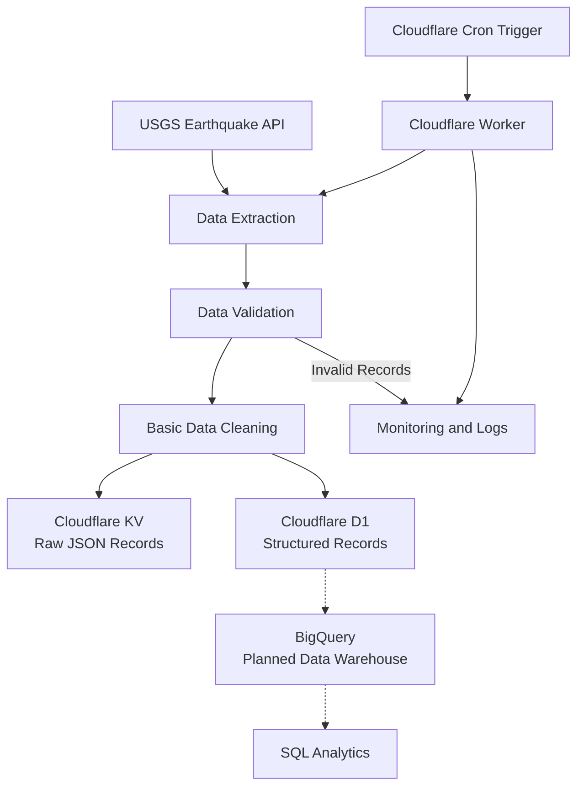

# Earthquake Monitoring System

A cloud-based earthquake data ingestion and monitoring system built using **Cloudflare Workers**, **Cloudflare Cron Triggers**, **Cloudflare D1**, and **Cloudflare KV**.

The system collects earthquake event data from the public **USGS Earthquake API**, performs basic data validation and cleaning, and stores the collected information using both NoSQL and relational database technologies.

The project demonstrates a lightweight cloud data engineering pipeline that automates data ingestion and supports future earthquake data analysis.

---

## Project Overview

Earthquakes occur around the world every day. Public earthquake data provides valuable information about seismic activity, including earthquake magnitude, geographical location, depth, and occurrence time.

This project aims to develop a cloud-based system that automatically collects earthquake information and stores it in structured and unstructured storage systems.

The ingestion process is executed entirely in the cloud using Cloudflare Workers. A scheduled Cloudflare Cron Trigger can automatically initiate data collection without requiring a continuously running local computer.

### Main Objectives

- Collect earthquake event data from the USGS Earthquake API.
- Automate data ingestion using Cloudflare Cron Triggers.
- Perform basic data validation and cleaning.
- Store original API responses in Cloudflare KV.
- Store cleaned and structured earthquake records in Cloudflare D1.
- Prevent duplicate records using unique earthquake event IDs.
- Monitor ingestion execution and identify errors.
- Prepare the collected data for future analytical processing.

---

## System Architecture



### Architecture Components

| Component | Technology | Responsibility |
|---|---|---|
| Data Source | USGS Earthquake API | Provides earthquake event data |
| Scheduler | Cloudflare Cron Triggers | Schedules automatic ingestion |
| Processing | Cloudflare Workers | Executes extraction, validation, and loading |
| NoSQL Storage | Cloudflare KV | Stores original earthquake JSON records |
| Relational Storage | Cloudflare D1 | Stores cleaned earthquake records |
| Data Warehouse | Google BigQuery (planned) | Future analytical storage |
| Monitoring | Cloudflare Observability | Helps monitor execution and errors |

---

## Technologies Used

### Cloud Platform
- Cloudflare Workers
- Cloudflare Cron Triggers
- Cloudflare D1
- Cloudflare KV
- Cloudflare Observability

### Programming and Data Technologies
- JavaScript
- SQL
- REST API
- JSON

### Data Source
- [USGS Earthquake API](https://earthquake.usgs.gov/fdsnws/event/1/)

### Version Control
- Git
- GitHub

### Planned Technology
- Google BigQuery for analytical data warehousing.

---

## Data Source

The system uses the United States Geological Survey (USGS) Earthquake API.

Official API documentation:

https://earthquake.usgs.gov/fdsnws/event/1/

The API provides earthquake event information in GeoJSON format.

### Main Data Fields

| Field | Description |
|---|---|
| Event ID | Unique earthquake event identifier |
| Magnitude | Measured earthquake magnitude |
| Place | Human-readable earthquake location |
| Time | Date and time of the earthquake |
| Depth | Earthquake depth in kilometres |
| Longitude | Geographic longitude |
| Latitude | Geographic latitude |
| Event URL | Link to the original USGS event information |

The system extracts the relevant fields and prepares them for storage.

---

## Data Ingestion Workflow

The pipeline follows these main stages:

### 1. Data Extraction

The Cloudflare Worker sends an HTTP request to the USGS Earthquake API and retrieves earthquake event records.

### 2. Data Validation

Each record is checked for essential information, including:

- A valid earthquake event ID.
- A valid magnitude value.
- A valid event timestamp.
- Valid geographic coordinates.
- Valid depth information.

Records that do not satisfy the required validation rules can be excluded from structured storage and recorded for monitoring.

### 3. Basic Data Cleaning

The system performs basic cleaning operations, such as:

- Selecting the required fields.
- Handling missing or invalid values.
- Converting timestamps into a consistent format.
- Ensuring numeric fields use appropriate data types.

### 4. Data Loading

Validated earthquake records are stored in two different storage systems.

**Cloudflare KV**

Stores the original JSON representation of earthquake events.

**Cloudflare D1**

Stores cleaned and structured earthquake information in a relational table.

### 5. Duplicate Prevention

The USGS event ID is used as a unique identifier.

The system uses this identifier to prevent duplicate records when the same earthquake event is retrieved during multiple ingestion runs.

### 6. Monitoring

The ingestion process can record:

- Total records fetched.
- Valid records.
- Invalid records.
- Successful storage operations.
- Execution errors.

---

## Cloud Storage Design

### Cloudflare KV – NoSQL Database

Namespace:

`EARTHQUAKE_RAW_DATA`

Purpose:

- Store original earthquake event JSON data.
- Preserve the source representation of collected records.
- Allow retrieval of raw event information.

### Cloudflare D1 – Relational Database

Database:

`earthquake-monitor-db`

Binding:

`DB`

Proposed table structure:

**Table: earthquakes**

| Column | Data Type | Description |
|---|---|---|
| event_id | TEXT | Primary key |
| magnitude | REAL | Earthquake magnitude |
| place | TEXT | Earthquake location |
| event_time | TEXT | Event timestamp |
| depth_km | REAL | Depth in kilometres |
| longitude | REAL | Geographic longitude |
| latitude | REAL | Geographic latitude |
| event_url | TEXT | Original USGS event URL |
| ingestion_time | TEXT | Time the record was ingested |

---

## Project Structure

```text
earthquake_monitoring_system/
│
├── src/
│   └── index.js
│
├── wrangler.jsonc
│
├── package.json
│
└── README.md
```

---

## Cloud Deployment

The application is designed to run using Cloudflare Workers.

### Deployment Configuration

The project uses `wrangler.jsonc` to define the Worker configuration and storage bindings.

The main configuration includes:

- Worker name: `earthquake-monitoring-system`
- Entry point: `src/index.js`
- D1 binding: `DB`
- KV binding: `RAW_DATA`

### Deployment

The Worker can be deployed using Wrangler:

```bash
npx wrangler deploy
```

The project is also connected to GitHub for automated deployment when supported repository changes are pushed.

---

## Free-Tier and Cost Management

This project is designed around free-tier cloud services wherever possible.

The selected services include:

- Cloudflare Workers for cloud-side execution.
- Cloudflare Cron Triggers for scheduled ingestion.
- Cloudflare D1 for relational storage.
- Cloudflare KV for NoSQL storage.

Usage limits and quotas must be monitored throughout development to avoid unexpected charges.

The project does not require a continuously running virtual machine or local data-processing server.

---

## Future Enhancements

The following improvements are planned for future development:

- Integrate Google BigQuery as an analytical data warehouse, subject to free-tier availability.
- Develop SQL-based earthquake analytics.
- Analyse earthquake frequency and magnitude distributions.
- Explore geographical earthquake patterns.
- Improve ingestion monitoring and error reporting.
- Develop a dashboard for visualising earthquake activity.

These are planned enhancements and are not considered completed implementation features.

---

## Academic Project

**Project Title:** Earthquake Monitoring System

**Module:** Cloud Data Engineering

**Programme:** HND in Data Science

**Institution:** NIBM

**Project Type:** Cloud-Based Data Engineering and Ingestion Prototype

---

## Data Source and References

- [USGS Earthquake API Documentation](https://earthquake.usgs.gov/fdsnws/event/1/)
- [Cloudflare Workers Documentation](https://developers.cloudflare.com/workers/)
- [Cloudflare D1 Documentation](https://developers.cloudflare.com/d1/)
- [Cloudflare KV Documentation](https://developers.cloudflare.com/kv/)
- [Cloudflare Cron Triggers Documentation](https://developers.cloudflare.com/workers/configuration/cron-triggers/)

---

**Earthquake Monitoring System**  
*A cloud-based approach to automated earthquake data ingestion and storage.*
